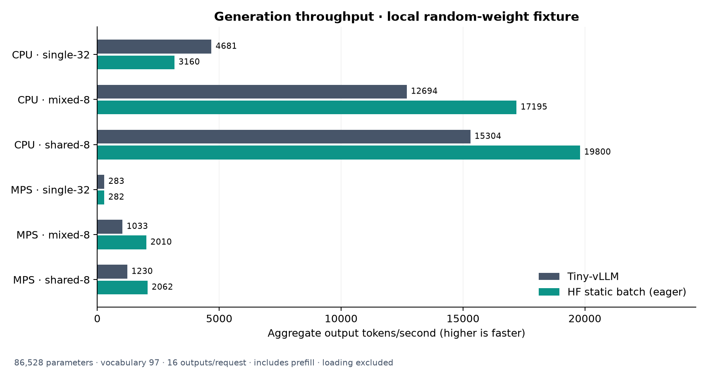

# Tiny-vLLM

Serving an LLM involves more than a forward pass. Requests arrive at different
times, prompts have different lengths, and cached tokens compete for memory.
Tiny-vLLM brings paging, batching, generation, and streaming together in a small
Python inference engine for CPU and Apple Silicon.

It includes:

- **Paged KV cache with prefix caching** — shared prompt prefixes reuse complete cached blocks.
- **Continuous batching with chunked prefill** — requests join and leave as generation progresses.
- **PyTorch reference attention** — grouped-query attention over paged K/V storage.
- **Checkpoint loading and sampling** — safetensors, greedy decoding, temperature, top-k, and top-p.
- **OpenAI-compatible HTTP endpoints** — completions, chat completions, and SSE streaming.
- **Optional MLX backend** — eager execution or compiled decode on Apple GPUs.

FlashAttention and CUDA graphs are not implemented in this Mac version.
Validation currently covers small Qwen3 configurations with random weights.
**96 tests pass**, including Hugging Face parity, CPU/MPS streaming, and MLX compilation checks.

## Install

Python 3.12:

```bash
python3.12 -m venv .venv
source .venv/bin/activate
pip install -r requirements.txt
```

For the optional Apple GPU backend:

```bash
pip install -r requirements-mlx.txt
MLX_ENABLE_TF32=0 python -m examples.generate --backend mlx --device mps --compile-decode
```

Compiled decode reduced generation latency by **20.7–24.5% versus eager MLX**
on the local 3.54M-parameter fixture. [MLX setup, results, and limits](docs/MLX.md).

## Usage

### One-off generation

Run a local demo without downloading weights:

```bash
python -m examples.generate --device cpu --max-tokens 16
```

For a compatible checkpoint:

```bash
python -m examples.generate --model /path/to/checkpoint --device mps \
  --prompt "The meaning of life is" --max-tokens 64
```

### Inference server

```bash
python -m tiny_vllm.serve --demo --device cpu --port 8000
```

Replace `--demo` with `--model <directory-or-hub-id>` to load a checkpoint.

| Flag | Default | Purpose |
| --- | --- | --- |
| `--device` | `cpu` | CPU or Apple GPU (`mps`) |
| `--port` | `8000` | HTTP port |
| `--max-model-len` | `512` | Prompt plus output token limit |
| `--num-blocks` | `129` | KV pages, including reserved page 0 |
| `--max-num-seqs` | `8` | Active request limit |
| `--max-num-batched-tokens` | `512` | Token budget per step |

The page pool must hold at least one max-length sequence; pages contain 16 tokens.

| Method | Path | Purpose |
| --- | --- | --- |
| GET | `/health` | Worker health |
| GET | `/v1/models` | Loaded model |
| GET | `/metrics` | JSON counts for running/waiting requests and free KV pages |
| POST | `/v1/completions` | Prompt text or token IDs |
| POST | `/v1/chat/completions` | Messages formatted with the tokenizer's chat template |

Stream a completion:

```bash
curl -N http://127.0.0.1:8000/v1/completions \
  -H 'Content-Type: application/json' \
  -d '{"prompt":"t4 t5 t6","temperature":0,"max_tokens":16,"stream":true}'
```

Requests accept `temperature`, `top_p`, `top_k`, `max_tokens` or
`max_completion_tokens`, `ignore_eos`, and `stream`. Sampling defaults come from
the model's generation config; the default output limit is the remaining context.
Chat also accepts `chat_template_kwargs`. Set `stream_options.include_usage` to
`true` for a final usage event. Text-only requests and one output per request are supported.

## Benchmark: Tiny-vLLM vs Hugging Face

Apple M5 · float32 · PyTorch 2.14.1 · one CPU thread · seven-run medians.

The local **86,528-parameter random Qwen3 fixture has a 97-token vocabulary**.
Each request generates 16 tokens. Throughput is total generated output tokens
divided by total wall time, including prefill; loading is excluded. These numbers
describe the small test fixture; trained models need separate measurements.

| Device | Workload | Tiny-vLLM output tok/s | HF static output tok/s |
| --- | --- | ---: | ---: |
| CPU | 1 request, 32-token prompt | 4,681 | 3,160 |
| CPU | 8 requests, mixed prompt lengths | 12,694 | 17,195 |
| CPU | 8 requests, shared 24-token prefix | 15,304 | 19,800 |
| MPS | 1 request, 32-token prompt | 283 | 282 |
| MPS | 8 requests, mixed prompt lengths | 1,033 | 2,010 |
| MPS | 8 requests, shared 24-token prefix | 1,230 | 2,062 |



HF uses eager attention with a padded static batch. Tiny-vLLM uses paged
reference attention and continuous batching. Every measured run produces
identical output token IDs.

```bash
python -m benchmarks.generation --devices cpu mps
python -m benchmarks.http --devices cpu mps
python -m benchmarks.charts
```

[Raw measurements and methodology](benchmarks/README.md) ·
[HTTP/SSE latency](benchmarks/results/http.png) ·
[Generation latency](benchmarks/results/generation.png)

## Local demos and tests

No model downloads are needed for these demos:

```bash
python -m examples.kv_demo
python -m examples.scheduler_demo
python -m examples.attention_demo --device mps
python -m examples.model_demo --device mps
python -m unittest discover -s tests -v
```

Use `cpu` when MPS is unavailable.

## Acknowledgments

The core engine is adapted from [priyammaz/tinyserve](https://github.com/priyammaz/tinyserve).

