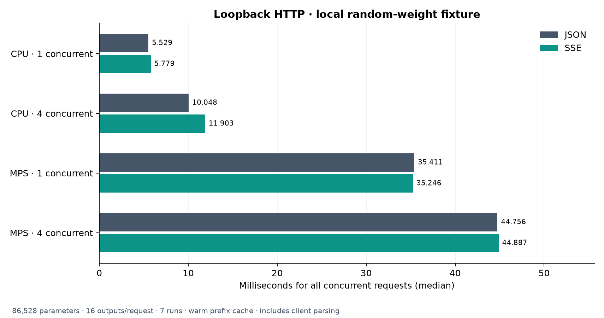

# Tiny-vLLM

LLM inference components for CPU and Apple Silicon, built up one part at a time.

- Paged KV cache with shared-prefix reuse.
- Continuous batching, chunked prefill, and request preemption.
- Qwen-style decoder layers with a PyTorch reference attention backend.
- Local or Hugging Face safetensors loading on CPU and MPS.
- Greedy, temperature, top-k, and top-p sampling.
- Offline generation with incremental output, EOS handling, and cancellation.
- Completion/chat HTTP endpoints with JSON and SSE streaming.

The generation loop connects the scheduler, model, cache, and sampler.
FlashAttention and CUDA graphs are not used on the Mac.

## Setup

Python 3.12:

```bash
python3.12 -m venv .venv
source .venv/bin/activate
pip install -r requirements.txt
python -m unittest discover -s tests -v
python -m examples.generate --device mps
```

Use `cpu` when MPS is unavailable. The demo uses random weights and a synthetic
vocabulary. For a compatible checkpoint, pass `--model <directory-or-hub-id>` and
`--prompt "Your prompt"`. **83 tests pass**, including generation parity, HTTP
validation, concurrent requests, and CPU/MPS streaming/disconnect checks.

## Serve

```bash
python -m tiny_vllm.serve --demo --device cpu
# For trained weights: --model <directory-or-hub-id> --device mps
```

In another terminal:

```bash
curl -N http://127.0.0.1:8000/v1/completions \
  -H 'Content-Type: application/json' \
  -d '{"prompt":"t4 t5 t6","temperature":0,"max_tokens":16,"stream":true}'
```

Also available: `/v1/chat/completions`, `/v1/models`, `/health`, and JSON `/metrics`.
Set `stream` to `false` for a single JSON response. Chat uses the loaded
tokenizer's template; only text and one output per request are supported.

## Benchmarks

Apple M5 · float32 · PyTorch 2.14.1 · one CPU thread. Seven-run medians, in ms.
Loopback HTTP uses an **86,528-parameter random model with vocabulary size 97**,
producing 16 tokens per request with a warm prefix cache.

| Device | Concurrent clients | JSON total | SSE total |
| --- | ---: | ---: | ---: |
| CPU | 1 | 5.53 | 5.78 |
| CPU | 4 | 10.05 | 11.90 |
| MPS | 1 | 35.41 | 35.25 |
| MPS | 4 | 44.76 | 44.89 |



Timing covers all concurrent requests, including client parsing. Output matches
Hugging Face. These tiny-fixture results exclude loading and do not represent
pretrained-model serving performance.

Run the latest benchmark and regenerate all Matplotlib charts:

```bash
python -m benchmarks.http --devices cpu mps
python -m benchmarks.charts
```

[Raw results and methodology](benchmarks/README.md) ·
[KV cache](benchmarks/results/kv_cache.png) ·
[Scheduler](benchmarks/results/scheduler.png) ·
[CPU attention](benchmarks/results/attention_cpu.png) ·
[MPS attention](benchmarks/results/attention_mps.png) ·
[Model](benchmarks/results/model.png) ·
[Loading](benchmarks/results/loading.png) ·
[Sampling](benchmarks/results/sampling.png) ·
[Offline generation](benchmarks/results/generation.png)

Implementation extracted and adapted from [tinyserve](https://github.com/priyammaz/tinyserve).
[Implementation notes](UPSTREAM.md).
