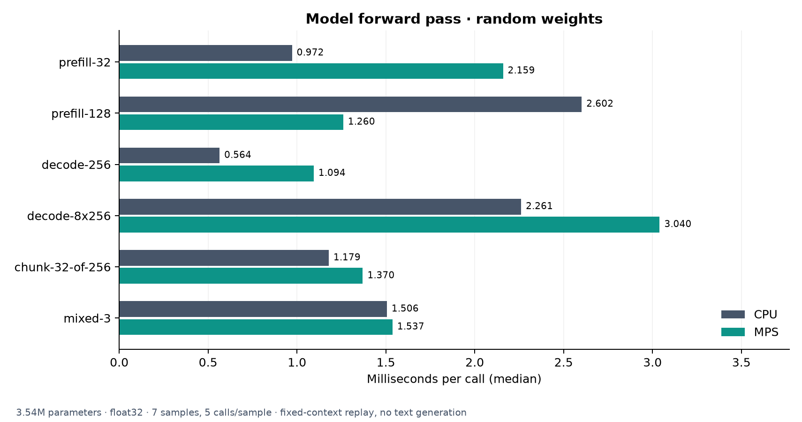
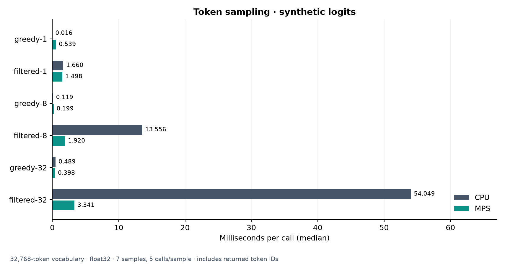

# Tiny-vLLM

LLM inference components for CPU and Apple Silicon, built up one part at a time.

- Paged KV cache with shared-prefix reuse.
- Continuous batching, chunked prefill, and request preemption.
- Qwen-style decoder layers with a PyTorch reference attention backend.
- Local or Hugging Face safetensors loading on CPU and MPS.
- Greedy, temperature, top-k, and top-p sampling.

The runner and text-serving API are next. FlashAttention and CUDA graphs are not
used on the Mac.

## Setup

Python 3.12:

```bash
python3.12 -m venv .venv
source .venv/bin/activate
pip install -r requirements.txt
python -m unittest discover -s tests -v
python -m examples.checkpoint_demo --device mps
```

Use `cpu` when MPS is unavailable. The demo uses a local random-weight checkpoint;
`--model <directory-or-hub-id>` loads a compatible checkpoint. **48 tests pass** on the M5,
including local Qwen3 checkpoint comparisons against Hugging Face.

## Benchmarks

Apple M5 · float32 · PyTorch 2.14.1 · one CPU thread. Times are medians.
Model tests use random weights; these are component timings, not generation speed.

| Workload | CPU | MPS |
| --- | ---: | ---: |
| Model prefill, 128 tokens (3.54M parameters) | 2.602 ms | 1.260 ms |
| Model decode, 1 token at context 256 | 0.564 ms | 1.094 ms |
| Filtered sampling, 8 requests × 32,768 logits | 13.556 ms | 1.920 ms |
| Local checkpoint load (86,528 parameters, warm filesystem cache) | 1.095 ms | 6.646 ms |





Run the latest benchmark and regenerate all Matplotlib charts:

```bash
python -m benchmarks.loading_sampling --devices cpu mps
python -m benchmarks.charts
```

[Raw results and methodology](benchmarks/README.md) ·
[KV cache](benchmarks/results/kv_cache.png) ·
[Scheduler](benchmarks/results/scheduler.png) ·
[CPU attention](benchmarks/results/attention_cpu.png) ·
[MPS attention](benchmarks/results/attention_mps.png) ·
[Loading](benchmarks/results/loading.png)

Implementation extracted and adapted from [tinyserve](https://github.com/priyammaz/tinyserve).
[Implementation notes](UPSTREAM.md).
