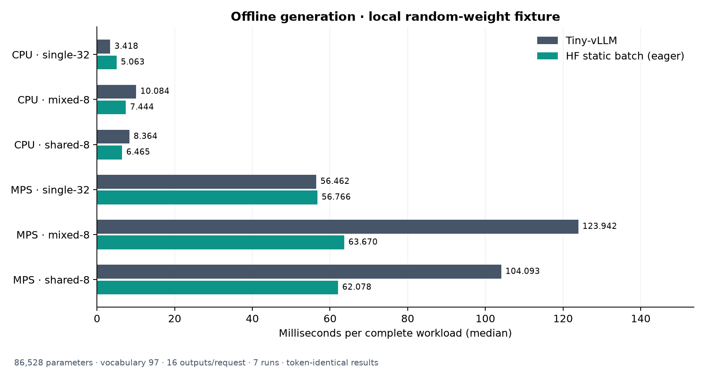

# Tiny-vLLM

LLM inference components for CPU and Apple Silicon, built up one part at a time.

- Paged KV cache with shared-prefix reuse.
- Continuous batching, chunked prefill, and request preemption.
- Qwen-style decoder layers with a PyTorch reference attention backend.
- Local or Hugging Face safetensors loading on CPU and MPS.
- Greedy, temperature, top-k, and top-p sampling.
- Offline generation with incremental output, EOS handling, and cancellation.

The generation loop connects the scheduler, model, cache, and sampler. HTTP
serving is next. FlashAttention and CUDA graphs are not used on the Mac.

## Setup

Python 3.12:

```bash
python3.12 -m venv .venv
source .venv/bin/activate
pip install -r requirements.txt
python -m unittest discover -s tests -v
python -m examples.generate --device mps
```

Use `cpu` when MPS is unavailable. The demo uses random weights and a synthetic
vocabulary. For a compatible checkpoint, pass `--model <directory-or-hub-id>` and
`--prompt "Your prompt"`. **62 tests pass**, including Hugging Face generation
parity, prefix reuse, preemption, and CPU/MPS checks.

## Benchmarks

Apple M5 · float32 · PyTorch 2.14.1 · one CPU thread. Seven-run medians, in ms.
Generation uses an **86,528-parameter random model with vocabulary size 97**,
producing 16 tokens per request. Every run matches Hugging Face's output tokens.

| Workload | Tiny-vLLM CPU | HF CPU | Tiny-vLLM MPS | HF MPS |
| --- | ---: | ---: | ---: | ---: |
| 1 request, 32-token prompt | 3.42 | 5.06 | 56.46 | 56.77 |
| 8 requests, mixed prompt lengths | 10.08 | 7.44 | 123.94 | 63.67 |
| 8 requests, shared 24-token prefix | 8.36 | 6.46 | 104.09 | 62.08 |



These are tiny-fixture results, not pretrained-model performance. HF uses eager
attention and one padded batch; Tiny-vLLM uses paged reference attention and
continuous batching. Model loading is excluded from timing.

Run the latest benchmark and regenerate all Matplotlib charts:

```bash
python -m benchmarks.generation --devices cpu mps
python -m benchmarks.charts
```

[Raw results and methodology](benchmarks/README.md) ·
[KV cache](benchmarks/results/kv_cache.png) ·
[Scheduler](benchmarks/results/scheduler.png) ·
[CPU attention](benchmarks/results/attention_cpu.png) ·
[MPS attention](benchmarks/results/attention_mps.png) ·
[Model](benchmarks/results/model.png) ·
[Loading](benchmarks/results/loading.png) ·
[Sampling](benchmarks/results/sampling.png)

Implementation extracted and adapted from [tinyserve](https://github.com/priyammaz/tinyserve).
[Implementation notes](UPSTREAM.md).
