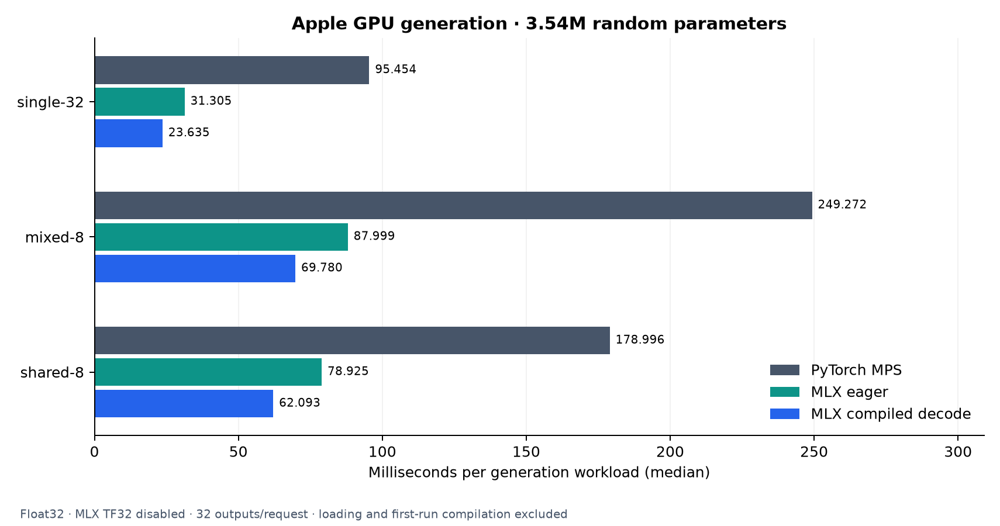

# MLX execution on Apple Silicon

The optional MLX backend runs the same Qwen-style decoder with native MLX arrays,
grouped-query attention, and functional paged-cache updates. The scheduler,
prefix-cache ownership manager, request lifecycle, and HTTP server are shared
with the PyTorch backend. PyTorch remains the default.

## Run

```bash
pip install -r requirements-mlx.txt
MLX_ENABLE_TF32=0 python -m examples.generate --backend mlx --device mps --compile-decode
MLX_ENABLE_TF32=0 python -m tiny_vllm.serve --demo --backend mlx --device mps --compile-decode
```

Omit `--compile-decode` for eager MLX. Replace the local demo with
`--model <directory-or-hub-id>` for a compatible checkpoint. Float32 is the only
supported MLX weight dtype in this implementation. Checkpoint loading currently
uses the validated PyTorch CPU loader once, then imports weights into MLX.
Generation stays in MLX; full logits cross back to PyTorch only when debugging
logprobs are requested. The device flag `mps` selects the Apple GPU here; the
actual execution framework is MLX.

## What is compiled

`mx.compile` wraps the pure forward function for batches with one query token per
request. Weights are read-only. Token IDs, positions, slot mappings, page tables,
valid lengths, and K/V state are explicit inputs; logits and updated cache arrays
are outputs. Cache state is materialized between scheduler steps.

Context sizes are bucketed by power-of-two page counts, capped at the context
limit. A tensor mask excludes padding and future positions. Actual lengths and
positions can change within a bucket without building another Python callable.
The cache retains at most 16 compiled callables per model, keyed by query layout
and context buckets. New batch layouts or buckets can still require compilation.
MLX maintains additional internal compilation/kernel caches.

Prefill and mixed multi-token batches stay eager. The model still gathers paged
K/V into dense prefixes for attention; it does not implement a custom paged Metal
kernel. Native MLX GQA avoids explicitly repeating KV heads. This is compiled
MLX execution, not CUDA-style command capture/replay.

## Measured results

Apple M5, macOS 26.6.2, Python 3.12.13, MLX 0.32.4, PyTorch 2.14.1. Both MLX
modes use the same native attention implementation, full float32, weights, and
workloads. Reduced-precision MLX matrix math is disabled. One PyTorch CPU thread
is used. No pretrained checkpoint was downloaded.

The untrained model has 3,541,504 parameters, four layers, hidden size 256, eight
query heads, two KV heads, head dimension 32, and vocabulary size 1,024.

### Offline generation

Each request generates 32 greedy tokens with EOS stopping disabled. Values are
seven-run medians. Mode order rotates between trials. Prefix metadata is reset
before every run; loaded weights and allocated cache pools are reused.

| Workload | PyTorch MPS, ms | MLX eager, ms | MLX compiled decode, ms | Reduction vs eager MLX |
| --- | ---: | ---: | ---: | ---: |
| One 32-token prompt | 95.45 | 31.31 | 23.63 | 24.5% |
| Eight mixed prompts, 16–128 tokens | 249.27 | 88.00 | 69.78 | 20.7% |
| Eight prompts sharing a 64-token prefix | 179.00 | 78.93 | 62.09 | 21.3% |



The single-request throughput was 1,022 output tokens/s eager and 1,354
compiled; eight shared-prefix requests reached 3,244 and 4,123 aggregate output
tokens/s respectively. These rates include prefill, scheduling, input packing,
sampling, and detokenization. Every measured output token sequence matched the
PyTorch CPU reference. Loading, warmup, and first-run compilation are excluded
from these steady-state medians.

### Fixed-shape forward calls

These timings include model execution, cache writes, and logits, but exclude
input construction. Each sample contains ten completed calls; seven samples are
collected after first-call measurement and three warmups.

| Workload | MLX eager, ms | MLX compiled decode, ms |
| --- | ---: | ---: |
| One decode query, context 128 | 0.780 | 0.589 |
| One decode query, context 512 | 0.794 | 0.760 |
| Eight decode queries, context 128 each | 2.154 | 1.537 |
| Eight decode queries, context 512 each | 2.136 | 1.469 |
| 128-token prefill control (both eager) | 1.133 | 1.129 |

Fixed calls replay the same positions instead of growing a sequence. The first
compiled decode-128 invocation took 213.52 ms versus 0.589 ms steady state. That
first call includes lazy runtime/kernel initialization as well as compilation;
it is not an isolated compiler measurement. Generation first-run values are also
saved, but occur later in the same process after kernels have been warmed.

The maximum logit difference across fixed calls and all three execution modes
was 1.32e-6 against PyTorch CPU, within absolute/relative tolerances of 3e-5.
See [raw samples and first-call costs](../benchmarks/results/mlx.json).

## Precision finding

MLX can use reduced-precision matrix operations even when inputs and outputs are
float32. Our initial 21-token prefill check had a maximum logit difference of
0.00085165 against PyTorch. Running with `MLX_ENABLE_TF32=0` reduced it to
9.69e-8, passing the original tolerance without relaxing it.

This was reproduced in two fresh processes with identical weights and inputs:
[precision results](../benchmarks/results/mlx_precision.json). Our MLX runtime
sets the variable to `0` by default before importing MLX and respects explicit
overrides. Set it at process launch to ensure it applies before any other code
initializes MLX. Numerical and performance comparisons here use `0` throughout.

## Reproduce

```bash
MLX_ENABLE_TF32=0 python -m unittest discover -s tests -v
MLX_ENABLE_TF32=0 python -m benchmarks.mlx
python -m benchmarks.mlx_precision
```

The suite covers eager/compiled logits and generation, bucket boundaries, prefix
reuse, disabled caching, preemption, EOS/context limits, filtered sampling, and
the async/HTTP worker. Optional MLX tests skip when MLX is not installed.

These small-model results do not establish trained-model performance. Larger
models, different dtypes, cold startup, and workloads exceeding the callable
cache require further measurement. PyTorch-to-MLX speed differences combine
framework/backend changes; only eager-MLX versus compiled-MLX isolates compilation.

References: [MLX compilation](https://ml-explore.github.io/mlx/build/html/usage/compile.html),
[native attention](https://ml-explore.github.io/mlx/build/html/python/_autosummary/mlx.core.fast.scaled_dot_product_attention.html),
[numerical precision](https://ml-explore.github.io/mlx/build/html/usage/precision.html).
